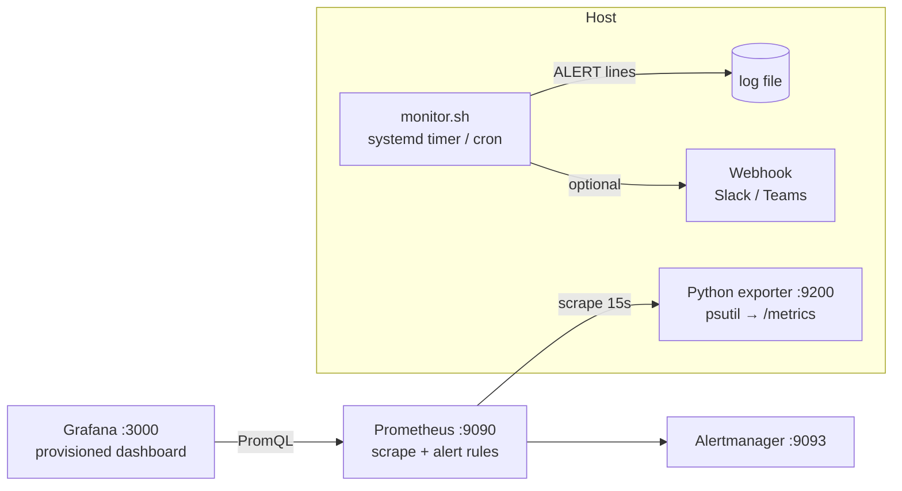

# Linux Server Monitoring


Monitoring for Linux servers at two levels:

1. **`monitor.sh`**: a dependency-free Bash health check for CPU, memory, disk, load and uptime. It has thresholds, a log file and webhook alerts, and runs from cron or a systemd timer.
2. **A metrics stack:**
   - a custom Python Prometheus exporter
   - Prometheus with alert rules
   - Alertmanager
   - a provisioned Grafana dashboard, all in Docker Compose

> Portfolio project, built and tested in a lab environment.

## Architecture



## What gets monitored

| Metric | Bash script | Prometheus metric | Alert |
|---|---|---|---|
| CPU usage | ✓ (from `/proc/stat`) | `server_cpu_usage_percent` | > 85% for 5m |
| Memory usage | ✓ (`MemAvailable`) | `server_memory_usage_percent` | > 90% for 5m |
| Disk usage per mount | ✓ (`df`) | `server_disk_usage_percent` | > 85% for 10m |
| Load average | ✓ | `server_load_average{period}` | — |
| Uptime | ✓ | `server_uptime_seconds` | reboot in last 10m |
| Exporter availability | — | `up{job="server"}` | down for 1m |

## Quick start

```bash
git clone https://github.com/AmanMasood/linux-server-monitoring.git
cd linux-server-monitoring
cp .env.example .env            # set a real Grafana password
docker compose up -d --build
```

- Grafana: http://localhost:3000. The **Server Monitoring → Linux Server Health** dashboard is pre-loaded.
- Prometheus: http://localhost:9090 (see *Alerts* for the rule status)
- Raw metrics: http://localhost:9200/metrics

### Bash health check

```bash
./scripts/monitor.sh                      # human-readable report
OUTPUT=json ./scripts/monitor.sh          # JSON for other tools
CPU_THRESHOLD=70 ALERT_WEBHOOK_URL=https://hooks.slack.com/... ./scripts/monitor.sh
```

Example output:

```
=== Server health: web-01 (2026-11-24 10:15:02) ===
Uptime : 12d 4h 37m
Load   : 0.42 0.35 0.30
CPU    : 7%
Memory : 41%
Disk   : /                    38%
```

Run every 5 minutes with systemd:

```bash
sudo cp scripts/monitor.sh /usr/local/bin/
sudo cp systemd/server-monitor.* /etc/systemd/system/
sudo systemctl enable --now server-monitor.timer
```

Or use cron: `*/5 * * * * /usr/local/bin/monitor.sh >/dev/null 2>&1`

## Testing

```bash
bash tests/test_monitor.sh                       # healthy, forced alert and JSON cases
pip install psutil pytest && pytest -q tests     # exporter unit tests
```

CI also:
- runs ShellCheck
- validates the alert rules with `promtool`
- starts the whole stack
- checks that Prometheus is really scraping the exporter

## Tech stack

Linux · Bash · Python · psutil · Prometheus · Alertmanager · Grafana · Docker Compose · systemd · GitHub Actions

## License

MIT
